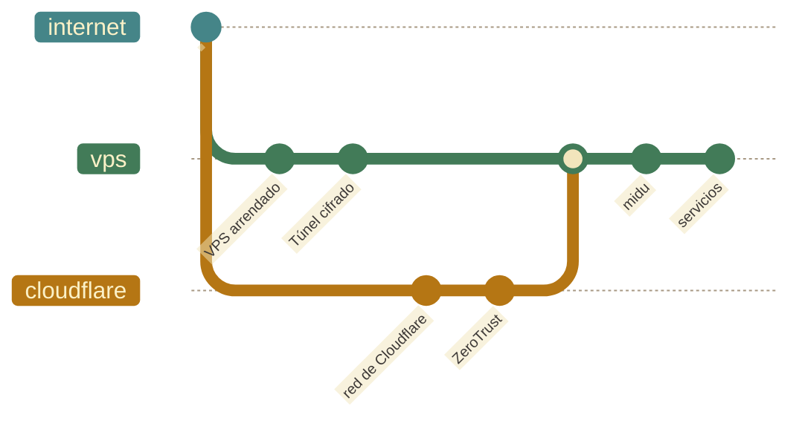
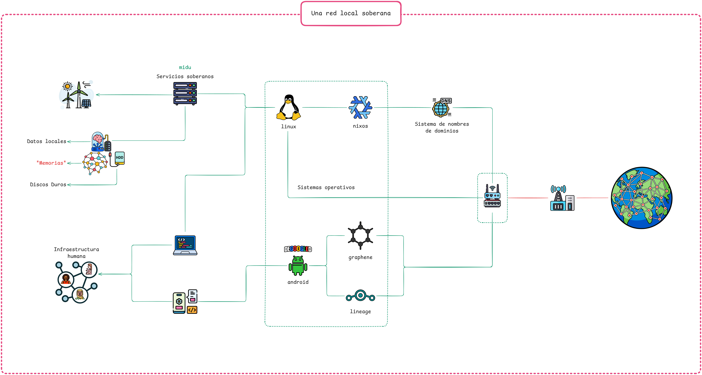

# Arquitectura del sistema

← [Inicio](../../README.md#la-midu)

La `midu` imita el funcionamiento de un organismo vivo. Tiene un núcleo en donde viven las `memorias`, una membrana que filtra el tráfico de entrada y un genoma que describe cómo se configura todo. Estas metáforas articulan la lógica de cada decisión técnica.

Esta sección desarrolla cada uno de estos conceptos: cómo se mueve el tráfico, qué función tiene cada `computador`, qué es NixOS, cómo se organizan los módulos, cómo se protegen los secretos. Juntos constituyen la propuesta de una `infraestructura` propia que sea comprensible, reproducible y soberana.

El tráfico de internet llega a la membrana: un `computador` arrendado (VPS) o la red de Cloudflare y su túnel ZeroTrust. La membrana recibe las solicitudes y las reenvía a través de un túnel cifrado hacia el `computador` local, sin exponer la dirección real del núcleo. Caddy recibe el tráfico dentro del `computador` local y lo distribuye a cada servicio después de que Authelia verifica la identidad de quien intenta acceder. Las `memorias` viven y se procesan únicamente en el `computador` local.

La [presentación animada](../lenguaje_común/visualizaciones/midu-una_red_local_soberana-slideshow.excalidraw.md) presenta la arquitectura de una `midu` elemento por elemento. Todas las visualizaciones están reunidas en la [cartografía de lo esencial](../lenguaje_común/cartografía_de_lo_esencial.md).

[**El `computador` local y el `computador` desechable**](arquitectura/computadores.md) son los anfitriones de nuestro sistema: el `computador` local almacena las `memorias` y ejecuta todos los servicios; el `computador` desechable actúa como intermediario público (membrana) y no sabe casi nada del núcleo. Esa asimetría define el modelo de amenaza: si el `computador` desechable es comprometido, los `datos` siguen seguros en el núcleo y podemos reemplazar la membrana completa rápidamente.

En las Rutas A y B, el `computador` desechable corre Pangolin, que gestiona los túneles y el enrutamiento HTTP/S. El protocolo del túnel es WireGuard; Newt es el cliente que corre en el `computador` local.

[**NixOS**](arquitectura/nixos.md) es el genoma del sistema: describe el estado completo de cada máquina en código.

[**El Nix Flake**](arquitectura/flake.md) es el punto de entrada: el archivo que declara las dependencias exactas y cómo ensamblarlas. El `flake.lock` fija la secuencia precisa para que dos máquinas construidas desde el mismo repositorio produzcan el mismo sistema.

[**El patrón dendrítico**](arquitectura/patrón_dendrítico.md): añadir un servicio nuevo se reduce a crear un archivo nuevo en el directorio correcto, sin modificar ningún archivo central.

[**Gestión de secretos**](arquitectura/secretos.md): la configuración vive en el repositorio; los secretos no. `age` cifra cada secreto para la máquina que lo necesita; `sops-nix` los descifra durante la construcción del sistema.

[**Las capas de la memoria**](arquitectura/capas_de_la_memoria.md): seis niveles en los que se pueden describir los estratos de las `memorias digitales` según la forma en la que se agregan objetos en los discos duros de la `midu`. La `soberanía` sobre las `infraestructuras` locales nos permite intervenir en la forma en la que esas capas organizan y transforman los `datos`.

[**Almacenamiento federado**](arquitectura/almacenamiento_federado.md): un modelo de tres capas de resiliencia y la topología de federación entre varias `midu`. Las `memorias` permanecen cifradas, fragmentadas y distribuidas geográficamente; ninguna `midu` alberga una copia completa de las `memorias` de otra pero juntas agregan una capa de resiliencia adicional a la posibilidad de pérdida de nuestras `memorias` individuales y colectivas.

[**Tipos de midu**](arquitectura/tipos_de_midu.md): el espectro de configuraciones de hardware que pueden darle forma a una `midu`, desde un `computador` reutilizado con un disco externo hasta un rack con cuatro tarjetas gráficas, con sus pros y contras respecto del gabinete de 8 Unidades, que usamos como una configuración de referencia.

[**Estimaciones**](arquitectura/estimaciones.md): los valores aproximados de cada configuración: costo del hardware, consumo de energía, horas de trabajo humano para la puesta en marcha, la configuración inicial de los servicios, y los costos fijos recurrentes.

## La `interfaz` descrita en código

Estos son los archivos más importantes del repositorio:

| Archivo | Descripción |
|---|---|
| `config.nix.template` | Plantilla de configuración del `computador` local |
| `config-vps.nix.template` | Plantilla de configuración del computador desechable (VPS) |
| `config.nix` | Configuración del `computador` local; existe solo en el `computador` local, no se sube al repositorio |
| `config-vps.nix` | Configuración del VPS; existe solo en el VPS, no se sube al repositorio |
| `flake.nix` | Punto de entrada de Nix Flakes |
| `hardware-configuration.nix` | Generado automáticamente por el instalador; no editar ni subir al repositorio |
| `home/default.nix` | Configuración del entorno de usuario (home-manager) |
| `secrets/secrets.plain.template` | Plantilla de secretos del `computador` local; vacía en el repositorio |
| `secrets/secrets-vps.plain.template` | Plantilla de secretos del VPS; vacía en el repositorio |
| `secrets/secrets.yaml` | Secretos cifrados del `computador` local; no se sube al repositorio |
| `secrets/secrets-vps.yaml` | Secretos cifrados del VPS; no se sube al repositorio |
| `.sops.yaml.template` | Plantilla de reglas sops |
| `replicate-grub/` | ISOs y tema Ventoy para el USB de `replicación` |

Los archivos que no se suben al repositorio existen únicamente en la máquina donde deben estar: si alguien accede al repositorio, no encuentra nada que le sirva para comprometer el sistema. Los archivos `.template` contienen la estructura pero no los valores reales.

## Ver también

- [Conectarse en internet](arquitectura/conectarse_en_internet.md): cómo llega el tráfico externo hasta el `computador` local
- [`replicación`](replicación.md): cómo replicar tu propia `midu`
