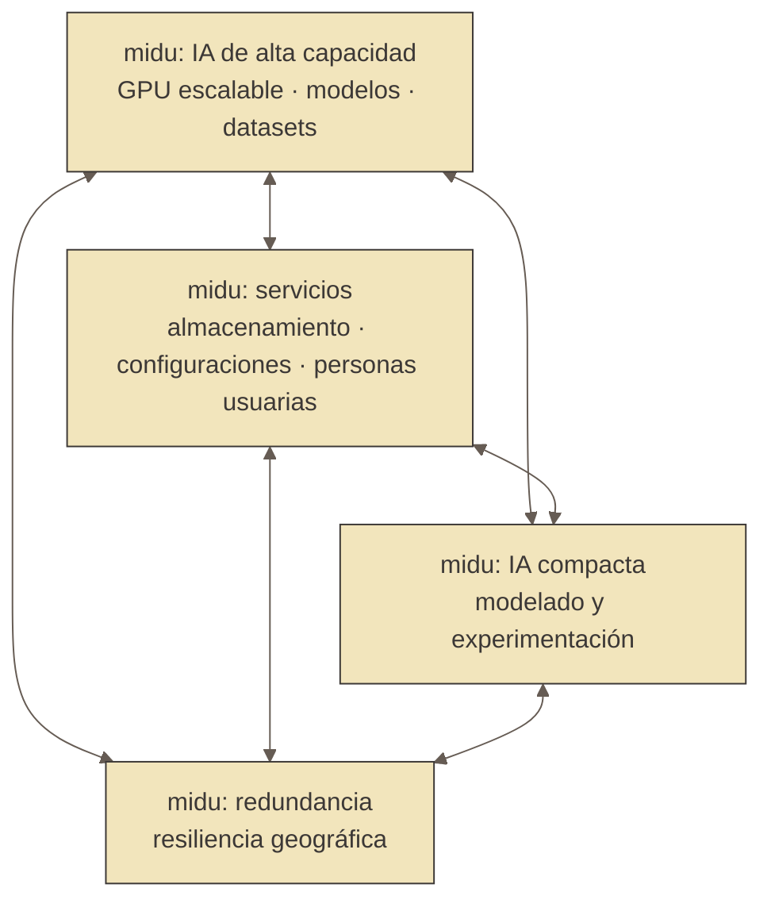

# Almacenamiento federado

El almacenamiento federado es una propuesta de cooperación entre dos o más [`midu`](../../midu.md) autónomas, cada una conserva capacidad propia de cómputo, almacenamiento, operación y custodia sus propias `memorias`; sin embargo, también participa en una red federada de recuperación en caso de desastre.

La red federada sostiene la recuperación ante la pérdida completa de una `midu`, el trabajo diario ocurre en el almacenamiento local de cada `midu`; la federación almacena una copia cifrada y distribuida de todas las `midu` que permite reconstruir cada una en caso de ser necesario.

## Las tres capas de resiliencia

El almacenamiento de cada `midu` se organiza en tres capas de resiliencia. Cada capa responde a un tipo y una escala de daño diferentes.

### Capa operativa: almacenamiento rápido local

Discos NVMe, rápidos e independientes para el trabajo diario.

```text
NVMe0: 1 TB
NVMe1: 3 TB
```

Contiene el sistema operativo, los contenedores, las máquinas virtuales, la caché, los datos temporales y los puntos de control durante el entrenamiento de modelos de inteligencia artificial o los datos de esos modelos necesarios para que estén activos como servicio dentro de una `midu`. Esta capa se reconstruye desde las capas superiores, de modo que no necesita respaldarse por  completo.

### Capa local: almacenamiento persistente local

Discos HDD con réplica local en espejo (RAID1).

```text
HDD0: 4 TB
+
HDD1: 4 TB
───────────
RAID1
```

La capacidad útil es:

$$
C_{\text{local}} = 4\text{ TB}
$$

Contiene la configuración de la `midu`, los modelos propios, las bases de `datos`, la información crítica y los `datos` necesarios para la reconstrucción. El RAID1 protege frente a la pérdida de un disco.

### Capa federada: almacenamiento distribuido entre dos o más `midu`

Una red de almacenamiento repartida entre `midu` independientes. Sostiene los respaldos cifrados que permiten la recuperación completa de una `midu` y su preservación histórica dentro de la red. La red puede puede estar distribuída en distintas ciudades o países.

#### Principio fundamental

La capa federada no replica todo lo que guarda la capa local, porque no toda la información local tiene el mismo valor. Definimos $D_i$ como la cantidad de `datos` críticos de la `midu` $i$.

$$
C_{\text{federado}} = D_i \times R
$$

donde $C_{\text{federado}}$ es la capacidad necesaria dentro de la federación, $D_i$ son los `datos` críticos y $R$ es el factor de resiliencia.

## `datos` críticos

Una `midu` puede tener:

```text
4 TB RAID1 local

Distribución:
  1 TB   modelos propios
  500 GB configuraciones
  500 GB bases de datos
  2 TB   datos regenerables
```

Los `datos` que realmente debemos proteger son:

$$
D_i = 2\text{ TB}
$$

Los `datos` regenerables se reconstruyen desde otras fuentes, así que no ocupan lugar en la capa federada.

## Factor de resiliencia

El factor de resiliencia representa cuánto almacenamiento adicional necesita la federación para garantizar la recuperación.

$$
R = \frac{C_{\text{federado}}}{D_i}
$$

Un factor $R = 1$ equivale a una copia exacta. Un factor $R > 1$ incorpora redundancia, fragmentación, tolerancia a fallos y margen operativo.

## Componentes del factor de resiliencia

El factor se expresa como:

$$
R = E \times S \times M
$$

donde $E$ es la eficiencia del esquema de almacenamiento, $S$ la disponibilidad esperada de la federación y $M$ el margen operativo.

### Eficiencia del esquema de almacenamiento

Para códigos de borrado:

$$
E = \frac{n}{k}
$$

donde $n$ es el número total de fragmentos y $k$ el mínimo necesario para la reconstrucción.

```text
10 fragmentos totales
 8 fragmentos necesarios
```

$$
E = \frac{10}{8} = 1.25
$$

Por cada 1 TB protegido se requieren $1.25\text{ TB}$ distribuidos.

### Factor de disponibilidad

Representa la posibilidad de que una parte de la federación esté temporalmente desconectada.

$$
S = \frac{1}{1 - p}
$$

donde $p$ es la proporción esperada de capacidad no disponible. Si esperamos que el 20% de la red pueda estar fuera:

$$
S = \frac{1}{0.8} = 1.25
$$

### Margen operativo

Absorbe el crecimiento, la reorganización, las reconstrucciones y el mantenimiento.

$$
M = 1 + g
$$

donde $g$ es el crecimiento esperado. Con un 10% de margen:

$$
M = 1.1
$$

## Topología de la federación

Tomamos como ejemplo una federación de cuatro tipos de `midu`, descritos por su rol. Las posibles configuraciones de hardware de cada tipo están en [tipos de `midu`](tipos_de_midu.md).



| Tipo de `midu` | Rol principal |
|---|---|
| IA de alta capacidad | Entrenamiento e inferencia con GPU escalable |
| Servicios | Servicios compartidos para la federación y para personas usuarias externas |
| IA compacta | IA local para modelado y experimentación |
| Redundancia | Redundancia/Resiliencia geográfica |

## Perfil de almacenamiento por tipo

Cada tipo describe aquí sólo sus capas de almacenamiento y sus `datos` críticos $D$. El cómputo, el hardware y los costos se describen con más detalle en [tipos de `midu`](tipos_de_midu.md) y en [estimaciones](estimaciones.md).

### `midu` de IA de alta capacidad

```text
Capa operativa: NVMe 2× 2 TB   →  SO, modelos activos, caché de inferencia
Capa local:     HDD 8 TB RAID1 →  modelos entrenados, datasets únicos permanentes

8 TB RAID1 útil:
  2.5 TB  modelos propios entrenados (no regenerables)
  1.0 TB  datasets únicos o propietarios
  0.5 TB  configuraciones y checkpoints clave
  4.0 TB  datasets públicos regenerables
```

$$
D_{\text{IA alta capacidad}} = 4\text{ TB}
$$

### `midu` de servicios

Sirve a las `midu` de la federación y a personas usuarias externas.

```text
Capa operativa: NVMe 2× 1 TB    →  SO, caché de servicios
Capa local:     HDD 12 TB RAID1 →  almacenamiento de personas usuarias internas y externas

12 TB RAID1 útil:
  1.5 TB  configuraciones de todas las midu y personas usuarias
  3.5 TB  datos de usuario críticos (internos y externos)
  7.0 TB  archivos temporales, caché y datos regenerables
```

$$
D_{\text{servicios}} = 5\text{ TB}
$$

### `midu` de IA compacta

Procesamiento de IA compacto para modelado y experimentación, independiente de la `midu` de IA de alta capacidad.

```text
Capa operativa: NVMe hasta 4 TB →  SO, modelos activos y datasets de trabajo
Capa local:     HDD 4 TB RAID1  →  resultados de experimentación, respaldos persistentes

4 TB RAID1 útil:
  1.5 TB  modelos de experimentación propios (no regenerables)
  0.5 TB  resultados, métricas y checkpoints relevantes
  2.0 TB  entornos de prueba, datasets temporales
```

$$
D_{\text{IA compacta}} = 2\text{ TB}
$$

### `midu` de redundancia

Puede asumir el rol de la `midu` de servicios si esta falla.

```text
Capa operativa: NVMe 1 TB      →  SO
Capa local:     HDD 8 TB RAID1 →  federación + capacidad de resiliencia de servicios

8 TB RAID1 útil:
  1.0 TB  configuraciones propias de la midu
  0.5 TB  datos operativos locales
  6.5 TB  dedicado a la federación y reserva de resiliencia de servicios
```

$$
D_{\text{redundancia}} = 1.5\text{ TB}
$$

La `midu` de redundancia dedica la mayor parte de sus 8 TB a la federación. Esa capacidad excedente es la que le permite asumir el rol de la `midu` de servicios cuando hace falta.

## Parámetros de la federación

### Código de almacenamiento

Esquema de borrado $10 + 8$:

$$
E = \frac{10}{8} = 1.25
$$

### Disponibilidad esperada

La red asume que hasta un 20% puede estar temporalmente fuera:

$$
S = \frac{1}{0.8} = 1.25
$$

### Margen operativo

Reservamos un 10%:

$$
M = 1.1
$$

Por lo tanto:

$$
R = 1.25 \times 1.25 \times 1.1
$$

$$
\boxed{R = 1.72}
$$

La federación necesita aproximadamente $1.72\text{ TB}$ federados por cada $1\text{ TB}$ de `datos` críticos.

### Capacidad federada requerida por tipo

$$
C_{\text{IA alta capacidad}} = 4\text{ TB} \times 1.72 = 6.88\text{ TB}
$$

$$
C_{\text{servicios}} = 5\text{ TB} \times 1.72 = 8.60\text{ TB}
$$

$$
C_{\text{IA compacta}} = 2\text{ TB} \times 1.72 = 3.44\text{ TB}
$$

$$
C_{\text{redundancia}} = 1.5\text{ TB} \times 1.72 = 2.58\text{ TB}
$$

### Capacidad total de la federación

`datos` críticos totales:

$$
D_{\text{total}} = 4 + 5 + 2 + 1.5 = 12.5\text{ TB}
$$

Capacidad federada requerida:

$$
C_{\text{total}} = 12.5 \times 1.72 = 21.5\text{ TB}
$$

La federación necesita aproximadamente:

$$
\boxed{22\text{ TB}}
$$

de almacenamiento distribuido para recuperar por completo las cuatro `midu`.

## Distribución posible de la federación

Cada `midu` aloja una porción de los fragmentos cifrados de la federación:

```text
midu de servicios     →  6 TB de fragmentos   (mayor cuota: midu central de servicios)
midu de IA alta cap.   →  4 TB de fragmentos
midu de IA compacta   →  4 TB de fragmentos
midu de redundancia   →  8 TB de fragmentos   (cuota máxima: redundancia + resiliencia de servicios)
─────────────────────────────
Total                  → 22 TB
```

Las `memorias` permanecen cifradas, fragmentadas y distribuidas geográficamente, sin una copia completa en una sola `midu`. La `midu` de redundancia alberga la cuota mayor porque su rol de resiliencia requiere capacidad suficiente para asumir los servicios cuando sea necesario.

## Principios de diseño

### Cada `midu` es autónoma

Puede operar aunque la federación esté temporalmente desconectada.

### La capa local es operacional

Sostiene la ejecución de los servicios, el entrenamiento, la inferencia y el trabajo con `datos` activos.

### La capa federada es de recuperación

Sostiene la reconstrucción de una `midu`, la preservación de la información y la supervivencia ante fallos catastróficos.

### La cuota depende del valor de los `datos`

La cuota federada depende del valor de los `datos`, no del tamaño bruto del disco. Una `midu` con 12 TB locales puede requerir sólo 8.6 TB federados si una parte de su información es crítica, como ocurre con la `midu` de servicios.

### La `midu` de redundancia puede asumir funciones operativas

La `midu` de redundancia no sólo almacena fragmentos federados: puede asumir el rol de la `midu` de servicios si esta cae. Esto implica más capacidad de HDD que la mínima para sus `datos` críticos propios y la `replicación` activa de sus propias configuraciones.

Este resiliencia de servicios es una capa de resiliencia adicional, por fuera de las tres capas. No se activa en la operación normal, sino ante la pérdida de la `midu` primaria.

## Ver también

- [tipos de `midu`](tipos_de_midu.md): las configuraciones de hardware de cada tipo, desde un `computador` reutilizado hasta un gabienete con varias GPU.
- [estimaciones](estimaciones.md): costos, consumo de energía y horas de trabajo de cada configuración.
- [las capas de la memoria](capas_de_la_memoria.md): los estratos de las `memorias`, distintos de estas capas físicas de resiliencia.
