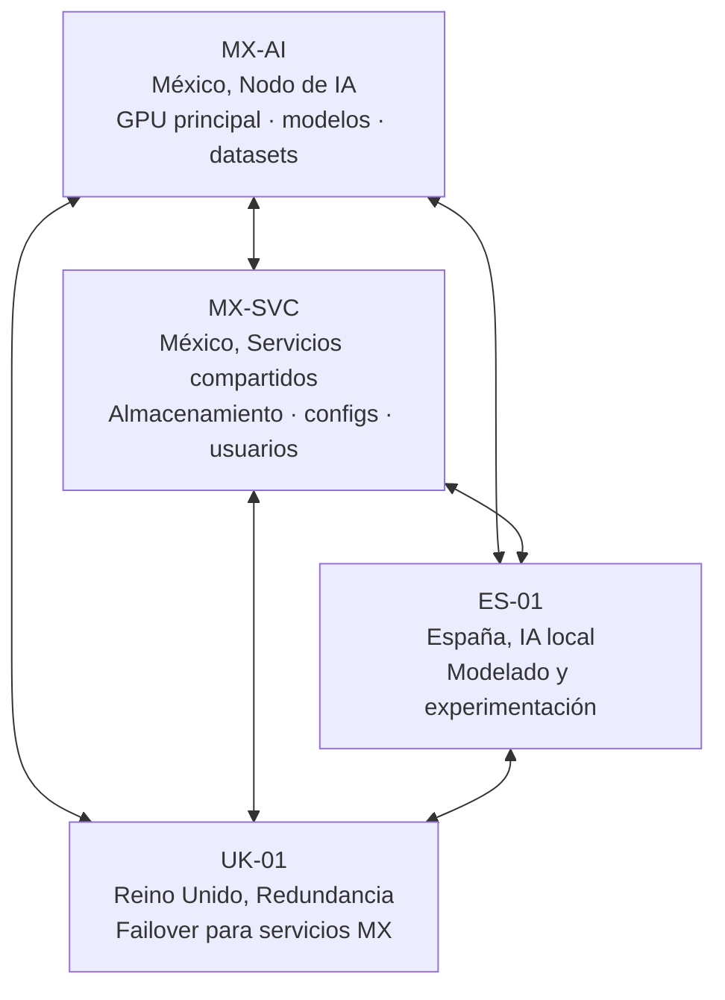

# Arquitectura federada de almacenamiento
## Introducción
La arquitectura propuesta consiste en una federación de nodos autónomos, donde cada nodo posee capacidad propia de cómputo, almacenamiento y operación independiente.

El objetivo no es construir un único clúster de baja latencia, sino una red distribuida donde cada nodo pueda:

- ejecutar inferencia;
- entrenar modelos localmente;
- almacenar información propia;
- participar en una red federada de recuperación;
- crecer de manera independiente.

La red federada no se utiliza como almacenamiento operativo diario, sino como una capa de resiliencia ante pérdida completa de nodos.

## Modelo de almacenamiento en tres niveles

Cada nodo tiene tres capas de almacenamiento.

### Nivel 0: almacenamiento rápido local

Está compuesto por discos NVMe independientes.

Ejemplo:

```text
NVMe0: 1 TB
NVMe1: 3 TB
```

Funciones:

- sistema operativo;
- contenedores;
- máquinas virtuales;
- caché;
- modelos activos;
- datasets temporales;
- checkpoints durante entrenamiento.

Este nivel no necesita ser respaldado completamente porque puede reconstruirse desde niveles superiores.

### Nivel 1: almacenamiento persistente local

Está compuesto por discos HDD con réplica local.

Ejemplo:

```text
HDD0: 4 TB
+
HDD1: 4 TB
───────────
RAID1
```

La capacidad útil es:

$$
C_{\text{local}} = 4\text{ TB}
$$

Este nivel contiene:

- configuración del nodo;
- modelos propios;
- bases de `datos`;
- información crítica;
- `datos` necesarios para reconstrucción.

El RAID1 protege frente a la pérdida de un disco.

### Nivel 2: almacenamiento federado

Es una red de almacenamiento distribuida entre nodos independientes.

Su función es:

- respaldos cifrados;
- snapshots;
- recuperación completa del nodo;
- preservación histórica.

La red puede estar formada por nodos ubicados en diferentes ciudades o países.

#### Principio fundamental

El almacenamiento federado no debe ser igual al almacenamiento local. La razón es que no toda la información local tiene el mismo valor.

Definimos $D_i$ como la cantidad de `datos` críticos del nodo $i$.

Entonces:

$$
C_{\text{federado}} = D_i \times R
$$

donde:

- $C_{\text{federado}}$ es la capacidad necesaria dentro de la federación;
- $D_i$ son los `datos` críticos;
- $R$ es el factor de resiliencia.

## `datos` críticos

Un nodo puede tener:

```text
4 TB RAID1 local

Distribución:
  1 TB   modelos propios
  500 GB configuraciones
  500 GB bases de `datos`
  2 TB   `datos` regenerables
```

Los `datos` que realmente deben protegerse son:

$$
D_i = 2\text{ TB}
$$

Los `datos` regenerables no necesitan ocupar espacio en el nivel federado.

## Factor de resiliencia

El factor de resiliencia representa cuánto almacenamiento adicional necesita la federación para garantizar recuperación.

La definición básica es:

$$
R = \frac{C_{\text{federado}}}{D_i}
$$

Un factor $R = 1$ significaría una copia exacta.

Un factor $R > 1$ incluye redundancia, fragmentación, tolerancia a fallos y margen operativo.

## Componentes del factor de resiliencia

El factor puede expresarse como:

$$
R = E \times S \times M
$$

donde:

- $E$ representa la eficiencia del esquema de almacenamiento;
- $S$ representa la disponibilidad esperada de la federación;
- $M$ representa el margen operativo.

### Eficiencia del esquema de almacenamiento

Para códigos de borrado:

$$
E = \frac{n}{k}
$$

donde:

- $n$ es el número total de fragmentos;
- $k$ es el número mínimo de fragmentos necesarios para reconstrucción.

Ejemplo:

```text
10 fragmentos totales
 8 fragmentos necesarios
```

Entonces:

$$
E = \frac{10}{8} = 1.25
$$

Por cada 1 TB protegido se requieren $1.25\text{ TB}$ distribuidos.

### Factor de disponibilidad

Representa la posibilidad de que una parte de la federación esté temporalmente desconectada.

Se define como:

$$
S = \frac{1}{1 - p}
$$

donde $p$ es la proporción esperada de capacidad no disponible.

Ejemplo: si se espera que el 20% de la red pueda estar fuera:

$$
S = \frac{1}{0.8} = 1.25
$$

### Márgen operativo

Permite absorber:

- crecimiento;
- reorganización;
- reconstrucciones;
- mantenimiento.

Se define como:

$$
M = 1 + g
$$

donde $g$ es el crecimiento esperado.

Ejemplo con 10% de margen:

$$
M = 1.1
$$

## Topología de la federación

La red tiene cuatro nodos en tres países:



| Nodo | Ubicación | Rol principal |
|---|---|---|
| MX-AI | México | Entrenamiento e inferencia con GPU potente |
| MX-SVC | México | Servicios compartidos para todos los nodos y usuarios externos |
| ES-01 | España | IA local para modelado y experimentación |
| UK-01 | Reino Unido | Redundancia geográfica y failover de servicios MX |

## Características de los nodos

## Nodo MX-AI: nodo principal de inteligencia artificial

Nodo de entrenamiento e inferencia con GPU escalable. La configuración de GPUs determina la plataforma de cómputo necesaria: de 1 a 2 unidades cabe en una plataforma ATX estándar; de 3 a 4 requiere una plataforma EATX de grado workstation o un servidor especializado.

```text
1–4× RTX 5090 32 GB  →  configurable según presupuesto y carga de trabajo
128 GB DDR5   (configuración 1–2 GPU, plataforma ATX)
256 GB DDR5 ECC  (configuración 3–4 GPU, plataforma EATX / servidor)
NVMe 2×2 TB  →  SO, modelos activos, caché de inferencia
HDD 8 TB RAID1  →  modelos entrenados, datasets únicos permanentes
```

Distribución de `datos` locales:

```text
8 TB RAID1 útil:
  2.5 TB  modelos propios entrenados (no regenerables)
  1.0 TB  datasets únicos o propietarios
  0.5 TB  configuraciones y checkpoints clave
  4.0 TB  datasets públicos regenerables
```

`datos` críticos:

$$
D_{\text{MX-AI}} = 4\text{ TB}
$$

## Nodo MX-SVC: nodo de servicios compartidos

Sirve a los nodos de la federación y a usuarios externos.

```text
Sin GPU (o integrada básica)
64 GB RAM
NVMe 2×1 TB  →  SO, caché de servicios
HDD 12 TB RAID1  →  almacenamiento de usuarios internos y externos
```

Distribución de `datos` locales:

```text
12 TB RAID1 útil:
  1.5 TB  configuraciones de todos los nodos y usuarios
  3.5 TB  `datos` de usuario críticos (internos y externos)
  7.0 TB  archivos temporales, caché y `datos` regenerables
```

`datos` críticos:

$$
D_{\text{MX-SVC}} = 5\text{ TB}
$$

## Nodo ES-01: nodo de IA local

Unidad de procesamiento de IA compacta para modelado y experimentación independiente del nodo MX-AI. Basado en NVIDIA DGX Spark, que integra CPU Arm, GPU Blackwell y memoria unificada en un factor de forma de escritorio.

```text
NVIDIA DGX Spark (GB10 Grace Blackwell Superchip)
72 núcleos Arm Neoverse N2
128 GB LPDDR5X  →  memoria unificada CPU + GPU (1000 AI TOPS FP8)
NVMe hasta 4 TB integrado  →  SO, modelos activos y datasets de trabajo
HDD 4 TB RAID1  →  resultados de experimentación, respaldos persistentes
```

Distribución de `datos` locales:

```text
4 TB RAID1 útil:
  1.5 TB  modelos de experimentación propios (no regenerables)
  0.5 TB  resultados, métricas y checkpoints relevantes
  2.0 TB  entornos de prueba, datasets temporales
```

`datos` críticos:

$$
D_{\text{ES-01}} = 2\text{ TB}
$$

## Nodo UK-01: nodo de redundancia geográfica

Puede asumir los servicios del nodo MX-SVC en caso de fallo.

```text
Sin GPU (o básica)
64 GB RAM
NVMe 1 TB  →  SO
HDD 8 TB RAID1  →  federación + capacidad de failover
```

Distribución de `datos` locales:

```text
8 TB RAID1 útil:
  1.0 TB  configuraciones propias del nodo
  0.5 TB  `datos` operativos locales
  6.5 TB  dedicado a la federación y reserva de failover
```

`datos` críticos propios:

$$
D_{\text{UK-01}} = 1.5\text{ TB}
$$

> El UK-01 dedica la mayor parte de sus 8 TB a la federación. Su capacidad excedente es lo que le permite asumir los servicios de MX-SVC en caso de failover.

## Parámetros de la federación

### Código de almacenamiento

Esquema de borrado $10 + 8$:

$$
E = \frac{10}{8} = 1.25
$$

### Disponibilidad esperada

La red asume que hasta un 20% puede estar temporalmente fuera:

$$
S = \frac{1}{0.8} = 1.25
$$

### Márgen operativo

Se reserva un 10%:

$$
M = 1.1
$$

Por lo tanto:

$$
R = 1.25 \times 1.25 \times 1.1
$$

$$
\boxed{R = 1.72}
$$

El sistema necesita aproximadamente $1.72\text{ TB}$ federados por cada $1\text{ TB}$ de `datos` críticos.

### Capacidad federada requerida por nodo

#### Nodo MX-AI

$$
C_{\text{MX-AI}} = 4\text{ TB} \times 1.72 = 6.88\text{ TB}
$$

#### Nodo MX-SVC

$$
C_{\text{MX-SVC}} = 5\text{ TB} \times 1.72 = 8.60\text{ TB}
$$

#### Nodo ES-01

$$
C_{\text{ES-01}} = 2\text{ TB} \times 1.72 = 3.44\text{ TB}
$$

#### Nodo UK-01

$$
C_{\text{UK-01}} = 1.5\text{ TB} \times 1.72 = 2.58\text{ TB}
$$

### Capacidad total de la federación

`datos` críticos totales:

$$
D_{\text{total}} = 4 + 5 + 2 + 1.5 = 12.5\text{ TB}
$$

Capacidad federada requerida:

$$
C_{\text{total}} = 12.5 \times 1.72 = 21.5\text{ TB}
$$

La federación necesita aproximadamente:

$$
\boxed{22\text{ TB}}
$$

de almacenamiento distribuido para recuperar completamente los cuatro nodos.

## Distribución posible de la federación

Cada nodo aloja una porción de los fragmentos cifrados de la federación:

```text
MX-SVC  →  6 TB de fragmentos   (mayor cuota: nodo central de servicios)
MX-AI   →  4 TB de fragmentos
ES-01   →  4 TB de fragmentos
UK-01   →  8 TB de fragmentos   (cuota máxima: redundancia + failover MX)
─────────────────────────────
Total   → 22 TB
```

Los `datos` permanecen:

- cifrados;
- fragmentados;
- distribuidos geográficamente (México, España, Reino Unido);
- sin una copia completa en un único nodo.

El UK-01 alberga la cuota mayor porque su rol de failover para los servicios de MX-SVC requiere que disponga de capacidad suficiente para asumir esa función cuando sea necesario.

## Principios de diseño

### Cada nodo es autónomo

Puede operar aunque la federación esté temporalmente desconectada.

### El almacenamiento local es operacional

Sirve para:

- ejecutar servicios;
- entrenar;
- inferir;
- trabajar con `datos` activos.

### El almacenamiento federado es una capa de recuperación

Sirve para:

- reconstruir nodos;
- preservar información;
- sobrevivir fallos geográficos.

### La cuota depende del valor de los `datos`

No depende del tamaño bruto del disco.

Un nodo con:

```text
12 TB locales
```

puede requerir solamente:

```text
8.6 TB federados
```

si solo una parte de su información es crítica (como ocurre con MX-SVC).

### El nodo de redundancia puede asumir funciones operativas

El UK-01 no solo almacena fragmentos federados: puede servir los servicios del nodo MX-SVC si este cae. Esto implica:

- mayor capacidad de HDD que la mínima para `datos` críticos propios;
- `replicación` activa de las configuraciones de servicio de MX-SVC.

Esta distinción es importante: el nivel 2 (federado) es para **recuperación**. El failover operativo es un cuarto nivel fuera del modelo de tres capas, no se activa en operación normal, sino ante la pérdida del nodo primario.

## Estimaciones

El diseño sigue un principio de **crecimiento modular**: cada configuración de rack incorpora los componentes del nivel anterior y agrega capacidad. Los costos de almacenamiento incluyen los HDDs dimensionados según la contribución esperada a la federación.

### Precios de referencia

| Componente | USD unitario |
|---|---:|
| RTX 5090 32 GB | $4,300 |
| DGX Spark (GB10) | $4,679 |
| HDD 2 TB | $114 |
| HDD 4 TB | $179 |
| HDD 6 TB | $200 |
| HDD 8 TB | $249 |
| HDD 16 TB | $579 |
| NVMe 1 TB | $179 |
| Mini PC (GMKtec G9 Plus) | $800 |
| RAM DDR5 128 GB (4×32 GB) | $1,800 |
| RAM DDR5 ECC 256 GB (8×32 GB) | $3,600 |

Precio de referencia RAM: $450 por módulo DDR5 32 GB.

### Componentes base

Presentes en todas las configuraciones de rack:

| Componente | Modelo referencia | USD |
|---|---|---:|
| Mini PC con OCuLink | GMKtec G9 Plus (Ryzen 9 8945HS) | $800 |
| NVMe 1 TB | Samsung 990 Pro | $179 |
| Pantalla táctil HDMI 7" | bracket 1U, conexión HDMI + USB | $100 |
| UPS 750 VA | APC BX750 | $130 |
| Enclosure 4 bahías HDD | ICY BOX IB-3640SU3 | $180 |
| Panel ventiladores 2×120 mm | Pure Wings 3 | $60 |
| Cables y accesorios |, | $50 |
| **Subtotal base (sin rack ni HDD)** | | **$1,499** |

La pantalla táctil se monta en el rack con un bracket de 1U y conecta directamente al mini PC por HDMI y USB. Permite monitorear y controlar el nodo localmente sin teclado ni ratón adicionales.

### Racks

Todos los racks son de aluminio: perfiles de extrusión de 19" estándar, con la rigidez estructural necesaria para cualquier tamaño de 8U a 18U. La impresión 3D es un recurso para las piezas de adaptación interna: el bracket de la pantalla táctil, las bandejas para mini PC o DGX Spark, las retenciones de cables, los paneles frontales y cualquier pieza de montaje que requiera una geometría específica del diseño.

| Concepto | USD |
|---|---:|
| Perfil de aluminio 19" + tornillería estructural | $80 – $150 |
| Diseño CAD (piezas de adaptación) | $150 – $300 |
| Impresión 3D PETG/ASA (brackets, bandejas, paneles) | $40 – $120 |
| **Total rack 8U – 12U armado** | **$270 – $570** |

Para racks de 14U a 18U, el peso acumulado de la workstation EATX y las UPS justifica un chasis prefabricado:

| Rack | Chasis prefabricado aluminio | USD |
|---|---|---:|
| 14U | perfil 19" + paneles laterales | $220 |
| 16U | perfil 19" + paneles laterales | $280 |
| 18U | perfil 19" + paneles laterales | $350 |

### Configuraciones de rack: crecimiento modular

#### Rack 8U: nodo base

```text
1U  mini PC (bandeja universal)
1U  pantalla táctil HDMI 7"
2U  enclosure 4 bahías HDD
1U  UPS 750 VA
1U  panel ventiladores
1U  gestión cables y accesorios
1U  espacio libre
══
8U
```

| Componente | USD |
|---|---:|
| Subtotal base | $1,499 |
| Rack 8U (aluminio + piezas 3D) | $120 |
| HDD local: 2× 2 TB RAID1 | $228 |
| HDD federado: 2× 2 TB RAID1 | $228 |
| **Total 8U** | **$2,075** |

*Local: 2 TB RAID1. Federado: 2 TB RAID1. Nodo de arranque o auxiliar con capacidad mínima en ambas capas.*

#### Rack 10U: nodo de servicios (añade networking)

```text
8U  base
1U  switch 8 puertos
1U  router + patch panel 12p
══
10U
```

| Componente adicional | USD |
|---|---:|
| Switch 8p gestionado (TP-Link TL-SG108E) | $45 |
| Router (GL.iNet GL-MT6000) | $90 |
| Patch panel 24p 1U | $60 |
| Rack diferencia (+2U) | $30 |
| HDD local: 2× 4 TB RAID1 (upgrade +$130 vs 8U) | $130 |
| HDD federado: 2× 4 TB RAID1 (nuevo) | $358 |
| **Subtotal adicional** | **$713** |
| **Total 10U servicios** | **$2,560** |

*Local: 4 TB RAID1 (`datos` de servicio y configuraciones). Federado: 4 TB RAID1 (fragmentos de otros nodos). Ambos pares escalan independientemente: el local puede crecer a 2× 6 TB ($400), 2× 8 TB ($498) o 2× 16 TB ($1,158); el federado crece para asumir mayor cuota en la red.*

#### Rack 10U: nodo con GPU (sin networking)

Reemplaza el espacio libre del 8U por un enclosure eGPU de 2U y actualiza la UPS. El mini PC se conecta a la GPU mediante OCuLink (equivalente a PCIe x4 Gen 4).

```text
1U  mini PC (bandeja)
1U  pantalla táctil HDMI 7"
2U  enclosure eGPU (perfil completo)
2U  enclosure 4 bahías HDD
2U  UPS 1500 VA
1U  panel ventiladores
1U  gestión cables
══
10U
```

| Componente adicional vs 8U | USD |
|---|---:|
| Enclosure eGPU OCuLink 2U | $160 |
| GPU (RTX 5090 32 GB) | $4,300 |
| UPS upgrade: 750 VA → 1500 VA (+$70) | $70 |
| Rack diferencia (+2U) | $30 |
| HDD local: 2× 4 TB RAID1 (upgrade +$130 vs 8U) | $130 |
| HDD federado: 2× 4 TB RAID1 (nuevo) | $358 |
| **Subtotal adicional** | **$5,048** |
| **Total 10U GPU** | **$6,895** |

*Local: 4 TB RAID1 (modelos activos y caché de inferencia). Federado: 4 TB RAID1 (almacenamiento de respaldo para otros nodos). Sin networking, opera en red local directa.*

#### Rack 12U: nodo de IA con networking

Combina el 10U GPU y añade networking completo.

```text
1U  mini PC (bandeja)
1U  pantalla táctil HDMI 7"
2U  enclosure eGPU (RTX 5090)
2U  enclosure 4 bahías HDD
2U  UPS 1500 VA
1U  switch 8 puertos
1U  router
1U  patch panel + gestión cables
══
12U (11U hardware · 1U libre)
```

| Componente adicional vs 10U GPU | USD |
|---|---:|
| Switch 8p gestionado | $45 |
| Router | $90 |
| Patch panel 24p 1U | $60 |
| Rack diferencia (+2U) | $30 |
| **Subtotal adicional** | **$225** |
| **Total 12U** | **$7,120** |

*Local: 4 TB RAID1 (modelos propios, datasets, checkpoints). Federado: 4 TB RAID1 (primer nodo con capacidad completa de IA y contribución activa a la federación).*

#### Transición de plataforma: de 1 GPU a 2 o más

El mini PC con OCuLink soporta **una GPU** a través del enclosure externo. Para configuraciones de 2, 3 o 4 GPUs se reemplaza el conjunto mini PC + eGPU por un **workstation rackmount de 4U** con ranuras PCIe internas. La pantalla, el networking, el almacenamiento y la UPS se mantienen; solo cambia la unidad de cómputo.

| Reemplaza | Por | Diferencia |
|---|---|---:|
| Mini PC $800 + eGPU enclosure $160 | Workstation 4U rackmount $3,280 | +$2,320 |

#### Rack 14U: dos GPUs

```text
4U  workstation rackmount ATX (2× GPU PCIe)
2U  enclosure 4 bahías HDD
2U  UPS 2000 VA
1U  pantalla táctil HDMI 7"
1U  switch 8 puertos
1U  router
1U  patch panel
1U  gestión cables
══
13U → rack 14U
```

Plataforma workstation 4U (1–2 GPU, ATX):

| Componente | USD |
|---|---:|
| Chasis 4U rackmount ATX (IStarUSA E4M10) | $380 |
| Placa madre Z790 (ASUS ROG Strix Z790-E) | $380 |
| CPU Intel Core i9-14900K | $420 |
| Cooler AIO 240 mm | $100 |
| 128 GB DDR5 (4×32 GB) | $1,800 |
| PSU 1200 W 80+ Gold | $200 |
| **Subtotal plataforma 4U ATX** | **$3,280** |

| Presupuesto completo 14U | USD |
|---|---:|
| Plataforma 4U ATX | $3,280 |
| 2× RTX 5090 32 GB | $8,600 |
| NVMe 2 TB (upgrade) | $300 |
| Enclosure 4 bahías HDD | $180 |
| UPS 2000 VA | $300 |
| Pantalla táctil HDMI 7" | $100 |
| Switch 8p + Router + Patch panel | $195 |
| Gestión cables | $50 |
| Rack 14U (aluminio prefabricado) | $220 |
| HDD local: 2× 6 TB RAID1 | $400 |
| HDD federado: 2× 6 TB RAID1 | $400 |
| **Total 14U** | **$14,025** |

*Local: 6 TB RAID1 (modelos entrenados, datasets únicos). Federado: 6 TB RAID1 (cuota de almacenamiento para fragmentos de otros nodos).*

#### Rack 16U: tres GPUs

Para alojar una tercera RTX 5090, la plataforma se actualiza al formato EATX que permite más ranuras PCIe y mayor capacidad de alimentación.

```text
4U  workstation rackmount EATX (3× GPU PCIe)
2U  enclosure 4 bahías HDD
3U  UPS 3000 VA
1U  pantalla táctil HDMI 7"
1U  switch 8 puertos
1U  router
1U  patch panel
1U  gestión cables
══
15U → rack 16U (1U libre)
```

| Diferencia desde 14U | USD |
|---|---:|
| Upgrade plataforma ATX → EATX (+$3,320 neto): case, MB, CPU, PSU×2, RAM | +$3,320 |
| 3ª RTX 5090 32 GB | +$4,300 |
| UPS upgrade: 2000 VA → 3000 VA | +$150 |
| Rack diferencia (14U → 16U) | +$60 |
| HDD local: upgrade 2× 6 TB → 2× 8 TB | +$98 |
| HDD federado: upgrade 2× 6 TB → 2× 8 TB | +$98 |
| **Diferencia total desde 14U** | **+$8,026** |
| **Total 16U** | **$22,051** |

*Local: 8 TB RAID1 (datasets extensos y modelos de mayor tamaño). Federado: 8 TB RAID1 (cuota ampliada en la red para un nodo de IA de mayor capacidad).*

Plataforma 4U EATX (3–4 GPU):

| Componente | USD | vs ATX |
|---|---:|---:|
| Chasis 4U rackmount E-ATX | $500 | +$120 |
| Placa madre EATX (ASUS Pro WS W790E-SAGE) | $800 | +$420 |
| CPU Intel Xeon W7-3455 | $800 | +$380 |
| Cooler industrial AIO 360 mm | $200 | +$100 |
| 256 GB DDR5 ECC (8×32 GB) | $3,600 | +$1,800 |
| 2× PSU 1600 W 80+ Platinum | $700 | +$500 |
| **Subtotal plataforma 4U EATX** | **$6,600** | **+$3,320** |

#### Rack 18U: cuatro GPUs

```text
4U  workstation rackmount EATX (4× GPU PCIe)
2U  enclosure HDD primario
2U  enclosure HDD secundario
4U  2× UPS 2000 VA
1U  pantalla táctil HDMI 7"
1U  switch 8 puertos
1U  router
1U  patch panel
1U  gestión cables
══
17U → rack 18U (1U libre)
```

| Diferencia desde 16U | USD |
|---|---:|
| 4ª RTX 5090 32 GB | +$4,300 |
| 2º enclosure 4 bahías HDD | +$180 |
| UPS upgrade: 3000 VA → 2× 2000 VA | +$150 |
| Rack diferencia (16U → 18U) | +$70 |
| HDD local enc2: 2× 8 TB RAID1 | +$498 |
| HDD federado enc2: 2× 8 TB RAID1 | +$498 |
| **Diferencia total desde 16U** | **+$5,696** |
| **Total 18U** | **$27,747** |

*Local: 16 TB RAID1 (enc1: 8 TB + enc2: 8 TB). Federado: 16 TB RAID1 (enc1: 8 TB + enc2: 8 TB). Capacidad máxima para el ciclo completo de entrenamiento: datasets activos, checkpoints, modelos y respaldo distribuido. Los `datos` críticos propios (≈4 TB) se distribuyen entre todos los nodos de la federación; el resto del almacenamiento federado aloja fragmentos de otros nodos.*

### Alternativas para múltiples GPUs

Las siguientes opciones son alternativas al workstation rackmount para configuraciones de 2–4 GPUs. No son parte de la progresión modular principal, pero son compatibles con el resto de la infraestructura de rack.

#### Computador de sobremesa (1–4 GPUs)

Una torre ATX o EATX se sitúa junto al rack de 10U–12U, que aloja networking, almacenamiento y UPS. Los costos son la plataforma más las GPUs; la infraestructura del rack se suma por separado.

| Configuración | Plataforma | GPUs | Solo cómputo |
|---|---:|---:|---:|
| 1 GPU (ATX) | $2,740 | $4,300 | $7,040 |
| 2 GPU (ATX) | $2,740 | $8,600 | $11,340 |
| 3 GPU (EATX) | $6,480 | $12,900 | $19,380 |
| 4 GPU (EATX) | $6,480 | $17,200 | $23,680 |

La infraestructura de rack (networking, almacenamiento, UPS) se agrega al costo total: desde $685 para un rack 10U básico.

#### Bandeja de 19": servidor 2U o 4U

Un servidor rackmount estándar de datacenter. Más caro que el workstation 4U pero diseñado para entornos de producción con soporte para mantenimiento remoto.

| Config | Chasis | GPUs | Solo cómputo |
|---|---:|---:|---:|
| 1–2 GPU (2U) | $2,300 | $4,300–$8,600 | $6,600–$10,900 |
| 3–4 GPU (2U especializado) | $5,700 | $12,900–$17,200 | $18,600–$22,900 |

Para 3–4 GPUs en 2U se requiere un chassis especializado con risers PCIe (Supermicro SYS-220GQ o equivalente).

### Presupuesto por nodo de la federación

| Nodo | Rack | CPU | RAM | vRAM | HDD local | HDD federado | Total |
|---|---|---|---:|---:|---:|---:|---:|
| **MX-AI** | 18U | Xeon W7-3455 | 256 GB DDR5 ECC | 128 GB (4× RTX 5090) | 16 TB | 8 TB | **$27,467** |
| **MX-SVC** | 10U servicios | Ryzen 9 8945HS | 32 GB LPDDR5X |, | 8 TB | 6 TB | **$2,921** |
| **ES-01** | 10U | GB10 (72c Arm) | 128 GB LPDDR5X | 128 GB | 2 TB | 4 TB | **$5,935** |
| **UK-01** | 10U servicios | Ryzen 9 8945HS | 32 GB LPDDR5X |, | 2 TB | 8 TB | **$2,570** |
| **Total** | | | | | **28 TB** | **26 TB** | **$38,893** |

* ES-01 usa memoria unificada CPU+GPU: los 128 GB son compartidos entre cómputo e inferencia (no se separan en RAM + vRAM).

**MX-AI (18U, 4× RTX 5090):** Workstation EATX rackmount con dos enclosures de 4 bahías. Enc1: 2× 8 TB local RAID1 + 2× 4 TB federado RAID1. Enc2: 2× 8 TB local RAID1 + 2× 4 TB federado RAID1. Total: 16 TB local + 8 TB federado (4 TB por enclosure × 2). Los `datos` críticos propios del nodo (≈4 TB) se distribuyen a los demás; los 4 TB federados restantes almacenan fragmentos de otros nodos. Costo vs 18U genérico ($27,747): ajustado por usar 2× 4 TB en lugar de 2× 8 TB en los pares federados de ambos enclosures (−$280 neto por rebalanceo).

**MX-SVC (10U servicios):** Mini PC con enclosure 4 bahías. Bays 1–2: 2× 8 TB local RAID1 (8 TB para configuraciones y `datos` de usuario). Bays 3–4: 2× 6 TB federado RAID1 (6 TB de fragmentos para la red). NVMe adicional 1 TB para sistema operativo de servicios.

**ES-01 (10U, DGX Spark):** La DGX Spark es una computadora completa; no usa mini PC. Enclosure 4 bahías: 2× 2 TB local RAID1 + 2× 4 TB federado RAID1.

**UK-01 (10U servicios):** Mini PC con enclosure 4 bahías. Bays 1–2: 2× 2 TB local RAID1 (`datos` propios del nodo). Bays 3–4: 2× 8 TB federado RAID1 (mayor cuota por su rol de redundancia y failover).

### Resumen consolidado

$$
\text{Total federación} = \underbrace{27{,}467}_{\text{MX-AI (18U, 4×GPU)}} + \underbrace{2{,}921}_{\text{MX-SVC}} + \underbrace{5{,}935}_{\text{ES-01}} + \underbrace{2{,}570}_{\text{UK-01}} = \$38{,}893
$$

La federación completa suma 28 TB de almacenamiento local útil (`datos` propios de cada nodo en RAID1) y 26 TB de almacenamiento federado (fragmentos cifrados de otros nodos almacenados localmente). Cada enclosure de 4 bahías divide sus drives en dos pares RAID1 independientes: uno para `datos` propios, uno para fragmentos de la federación.

### Rango de estimación ±10 %

| Nodo | −10 % | Estimación central | +10 % |
|---|---:|---:|---:|
| MX-AI | $24,720 | $27,467 | $30,214 |
| MX-SVC | $2,629 | $2,921 | $3,213 |
| ES-01 | $5,342 | $5,935 | $6,529 |
| UK-01 | $2,313 | $2,570 | $2,827 |
| **Total federación** | **$35,004** | **$38,893** | **$42,783** |

| Rack | −10 % | Estimación central | +10 % |
|---|---:|---:|---:|
| 8U | $1,868 | $2,075 | $2,283 |
| 10U servicios | $2,304 | $2,560 | $2,816 |
| 10U GPU | $6,206 | $6,895 | $7,585 |
| 12U IA + networking | $6,408 | $7,120 | $7,832 |
| 14U (2× GPU) | $12,623 | $14,025 | $15,428 |
| 16U (3× GPU) | $19,846 | $22,051 | $24,256 |
| 18U (4× GPU) | $24,972 | $27,747 | $30,522 |