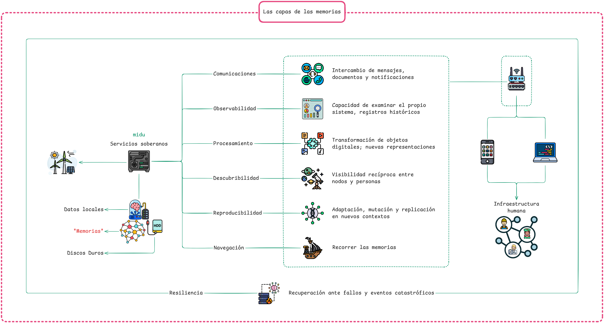
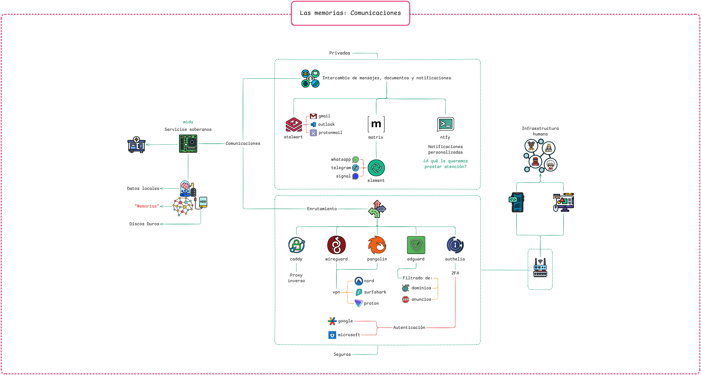
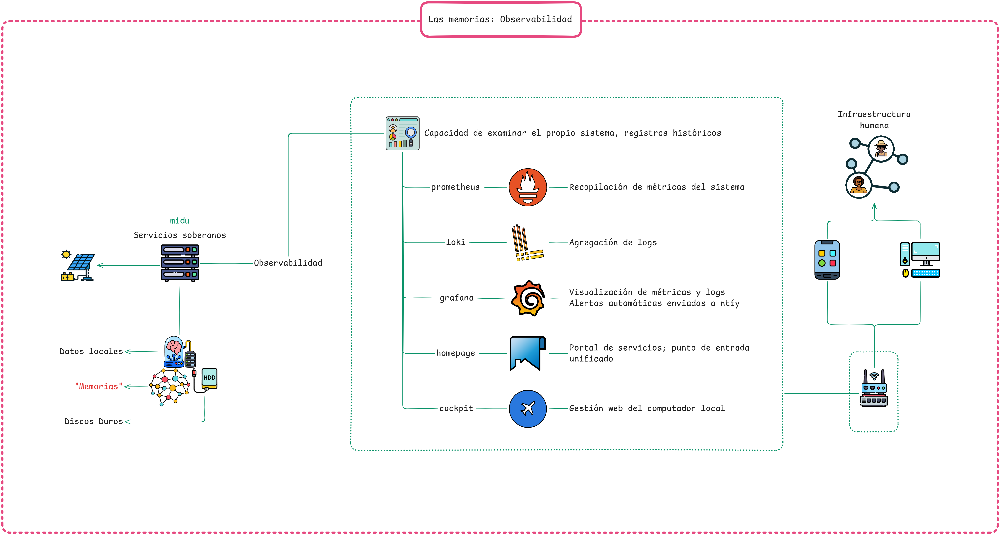
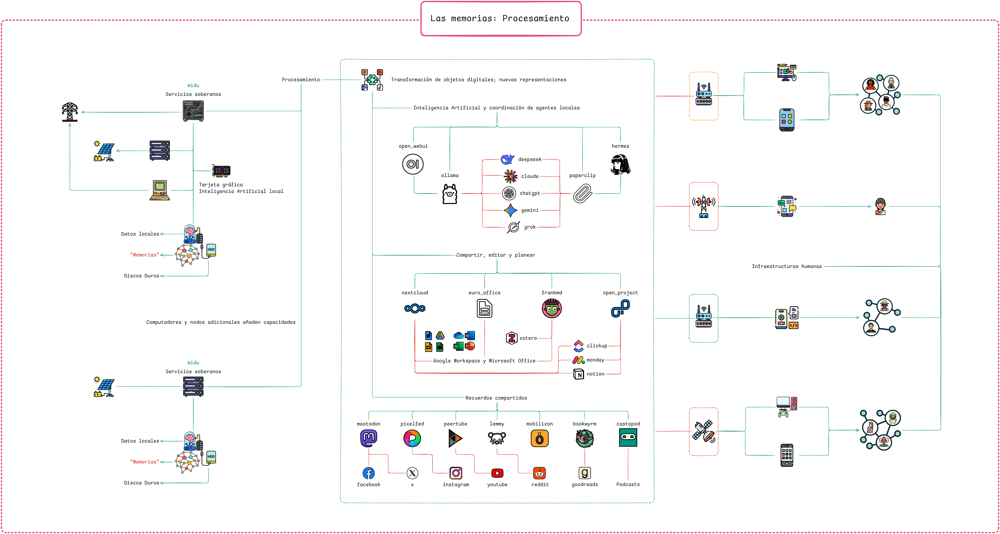
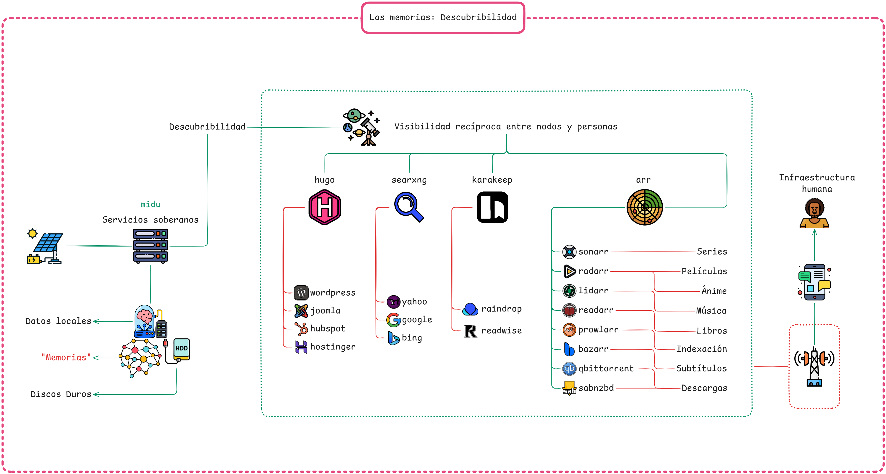
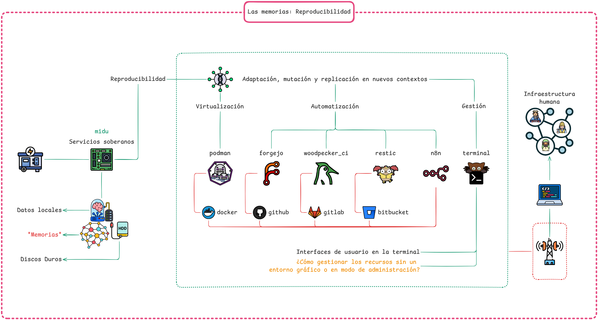
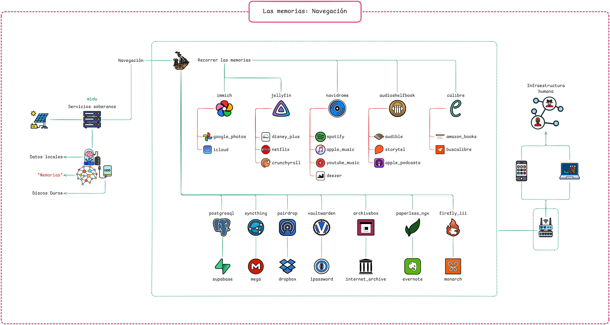

# Las capas de la memoria

← [Arquitectura](../arquitectura.md)

La `midu` no gestiona `datos` abstractos: gestiona `memorias`. Las `memorias` se organizan en capas funcionales que funcionan como la red de activación de una red neuronal: todas participan en los procesos de las demás y cada una se activa en distinto grado según la tarea.

Esta organización no es nueva. La imprenta organizó la memoria escrita en capas: quién podía producir tipos, quién podía costear una edición, quién tenía acceso a redes de distribución, quién sabía leer. La web comercial organizó la memoria digital en capas similares: quién controla los servidores de búsqueda, quién decide qué permanece almacenado, quién puede pagar por visibilidad. En ambos casos, las decisiones sobre cada capa determinan qué sobrevive.

La `midu` articula seis capas, cada una bajo nuestro control. Dos de ellas se despliegan en subcapas: las comunicaciones incluyen el enrutamiento, y el procesamiento incluye la colaboración y la participación. La `resiliencia` es una propiedad transversal que existe como principio fundamental en todas las capas. La `soberanía` se traduce en la capacidad técnica de determinar el comportamiento de estas capas. Los [servicios](../servicios.md) de la `midu` se organizan según esta misma arquitectura: cada servicio ocupa su lugar en una de estas capas.

## Las seis capas

```text
Las capas de la memoria
│
├─ 1. Comunicaciones       Intercambio de mensajes, documentos y notificaciones
│  └─ 1.1 Enrutamiento      El único camino hacia los servicios, con autenticación en cada paso
├─ 2. Observabilidad       Capacidad de examinar el propio sistema, registros históricos
├─ 3. Procesamiento        Transformación de objetos digitales; nuevas representaciones
│  ├─ 3.1 Colaboración      Producción conjunta sobre las mismas memorias
│  └─ 3.2 Participación     Presencia pública federada entre midu y con el Fediverso
├─ 4. Descubribilidad      Visibilidad recíproca entre nodos y personas
├─ 5. Reproducibilidad     Adaptación, mutación y replicación en nuevos contextos
└─ 6. Navegación           Recorrer las memorias
```



## 1. Comunicaciones



La capa de comunicaciones es la más inmediata: el intercambio de mensajes, documentos y notificaciones entre personas. Es también la más vigilada. Los metadatos de comunicación, quién envió qué a quién, cuándo, con qué frecuencia, tienen valor informacional incluso cuando el contenido está cifrado.

En la `midu`, la capa de comunicaciones incluye el correo electrónico ([Stalwart](../servicios/stalwart.md)), la mensajería instantánea federada ([Dendrite](../servicios/dendrite.md)) y las notificaciones push ([ntfy](../servicios/ntfy.md)). Cada servicio corre en el `computador` local: los metadatos no salen del sistema.

La federación agrega una consideración extra: cuando un servicio interactúa con participantes en otros servicios federados (Matrix), los metadatos de esas interacciones existen en todos los actores federados. Esta es una decisión consciente, la interoperabilidad tiene un costo en términos de control centralizado de los metadatos.

### 1.1 Enrutamiento

Para que ese intercambio con el exterior sea posible sin exponer la `midu`, las comunicaciones se apoyan en una subcapa de enrutamiento: la secuencia de puertas que todo tráfico atraviesa antes de llegar a cualquier servicio. Es la superficie de ataque mínima descrita en los [`cuidados`](../cuidados.md), y un camino que exige autenticación en cada paso.

El tráfico entra por el `computador` desechable ([Pangolin](../servicios/pangolin.md)) y viaja por un [túnel cifrado](../servicios/túnel_cifrado.md) hasta el `computador` local, que nunca expone su dirección. Allí lo recibe un proxy inverso ([Caddy](../servicios/caddy.md)), un DNS local que bloquea rastreo ([AdGuard](../servicios/adguard.md)) y un inicio de sesión único con segundo factor ([Authelia](../servicios/authelia.md)). Ningún servicio responde sin pasar por estas puertas.

## 2. Observabilidad



Sin observabilidad, la memoria existe pero no puede examinarse. Una biblioteca sin catálogo, un sistema sin métricas: los `datos` están ahí pero no podemos verlos.

La capa de observabilidad permite reflexionar sobre el sistema: qué recursos consume, qué errores produce, qué patrones emergen, y conserva los registros históricos de ese comportamiento. En la `midu` esto incluye métricas (Prometheus), logs (Loki y Promtail), visualización (Grafana) y alertas (Alertmanager). Un portal de servicios (Homepage) reúne el acceso a todo en un solo lugar, y una consola web (Cockpit) permite administrar el `computador` local.

La observabilidad también es una capa política. Quién puede ver las métricas del sistema determina quién puede auditarlo. En `infraestructuras` delegadas, la observabilidad está disponible para el proveedor, no para la comunidad que usa el servicio. La `soberanía` sobre los `datos` incluye la `soberanía` sobre la información de cómo esos `datos` se mueven.

## 3. Procesamiento



El procesamiento es la capa de las transformaciones: extraer texto de un documento, resumir conversaciones, identificar patrones, generar nuevas representaciones a partir de las existentes.

Esta capa concentra el debate sobre inteligencia artificial porque los modelos de lenguaje inscriben subjetividades en sus salidas. Un modelo entrenado sobre ciertos contenidos, con ciertos criterios de filtrado, produce ciertos tipos de textos y no otros. Delegar el procesamiento a servicios externos es delegar la producción de conocimiento a quien diseñó esos modelos.

En la `midu`, el procesamiento se apoya en modelos de lenguaje que corren en el `computador` local (Ollama), en una `interfaz` web para conversar con ellos (Open WebUI), en el procesamiento de `objetos digitales` con modelos de IA (Hermes) y en la coordinación de sus agentes (Paperclip). Ninguna de estas herramientas es neutral, pero podemos decidir sobre su presencia y auditarlas en el `computador` local.

El procesamiento no ocurre en soledad: se extiende en dos subcapas donde las transformaciones se vuelven colectivas y públicas.

### 3.1 Colaboración

La colaboración es la subcapa donde varias personas trabajan sobre las mismas `memorias`. Cubre la producción conjunta de documentos, la organización del conocimiento compartido y la coordinación del trabajo.

En la `midu`, incluye la plataforma colaborativa de archivos, documentos, calendario y contactos (NextCloud), la suite ofimática (EuroOffice), la gestión del conocimiento en Markdown con notas enlazadas (FrankMD) y la gestión de proyectos (OpenProject). Trabajar juntos sin ceder el contenido a una plataforma externa mantiene la `gobernanza` de esas `memorias` en la comunidad que las produce.

### 3.2 Participación

La participación es la subcapa de la presencia pública federada: cómo una `midu` se relaciona con otras `midu` y con el `Fediverso`. Cada servicio federado amplía la red de reciprocidad sin ceder el control de las `memorias` a una plataforma centralizada.

En la `midu`, incluye el microblogging federado (Mastodon), la publicación de fotos (Pixelfed), el video federado (PeerTube), el foro comunitario (Lemmy), los eventos y grupos (Mobilizon), la lectura social (Bookwyrm) y la publicación de podcasts (Castopod), todos sobre el protocolo `ActivityPub`.

La participación tiene también una dimensión de exclusión. Los estudios sobre el `Fediverso` documentan cómo las dinámicas de instancias pequeñas y grandes replican las exclusiones de la web centralizada: personas negras, trans y del Sur Global encuentran sus cuentas bloqueadas, defederadas o silenciadas por administradores que actúan como guardianes informales del espacio. Participar en la federación requiere decisiones explícitas de `gobernanza`: con quién se federa, qué instancias se bloquean, qué criterios de moderación se aplican. Estas decisiones producirán reglas distintas para comunidades distintas.

## 4. Descubribilidad



La descubribilidad responde a la pregunta de la visibilidad recíproca entre nodos y personas: cómo encontrar personas y `memorias` en la red. No basta con que algo exista: tiene que poder ser encontrado.

Esta capa es donde las diferencias entre federación y centralización son más visibles. La web centralizada resolvió la descubribilidad con motores de búsqueda que indexan todo y deciden qué aparece primero. La federación redistribuye el almacenamiento pero no resuelve automáticamente la descubribilidad: un nodo que nadie conoce no puede ser contactado.

En la `midu`, la descubribilidad incluye la publicación de la base de conocimientos como sitio navegable con [Hugo](../servicios/hugo.md), un motor de búsqueda que agrega resultados sin identificar a quien busca (SearXNG) y la gestión de marcadores y artículos guardados (Karakeep). Incluye también un stack de automatización de medios: series, películas, música y libros (Sonarr, Radarr, Lidarr y Readarr), coordinados por un gestor de indexadores (Prowlarr), con subtítulos (Bazarr) y clientes de descarga por torrent y Usenet (qBittorrent y SABnzbd). Gobernar la descubribilidad requiere decisiones explícitas sobre qué se publica, qué se indexa y para quién.

## 5. Reproducibilidad



La reproducibilidad es la condición de que el sistema pueda sobrevivir fuera del entorno en que fue creado: adaptarse, mutar, replicarse en nuevos `contextos` con personas y `dispositivos` distintos.

La imprenta se volvió viable porque el conocimiento de cómo construir una prensa, operar un taller tipográfico y distribuir textos se diseminó de maneras que permitieron que otros lo adaptaran a sus condiciones. Cada taller incorporó las subjetividades del lugar donde se instalaba.

En la `midu`, la reproducibilidad descansa en la infraestructura como código (NixOS), la documentación transferible y el [patrón dendrítico](patrón_dendrítico.md). Sobre esta capa se apoyan la [virtualización](../servicios/virtualización.md) de los servicios en contenedores, las herramientas de [terminal](../servicios/terminal.md) para administrar el sistema, el repositorio git auto-hospedado (Forgejo), la integración continua del flake (Woodpecker CI), la automatización de flujos de trabajo (n8n) y los backups cifrados (Restic). Lo que se replica es la capacidad: el conocimiento de cómo construir y mantener la `interfaz`, transferible a otra persona, otra comunidad y otro `contexto`.

## 6. Navegación



Recorrer las memorias: la navegación es la capa donde las `memorias` y los `datos` viven físicamente y donde los consultamos, recorremos y servimos. Reúne el almacenamiento estructurado que usan los servicios, la sincronización de archivos entre `dispositivos`, la gestión de credenciales, los archivos de trabajo y las bibliotecas que organizan y sirven lo guardado.

En la `midu`, la navegación incluye la base de `datos` compartida por varios servicios ([PostgreSQL](../servicios/postgresql.md)), la sincronización de archivos entre `dispositivos` sin servidores externos ([Syncthing](../servicios/syncthing.md)), el gestor de contraseñas cifrado ([Vaultwarden](../servicios/vaultwarden.md)), la gestión documental con OCR (Paperless-ngx), el archivo web local (Archivebox), la transferencia efímera de archivos (Pairdrop) y la gestión de finanzas personales (Firefly III). A ellos se suma una biblioteca de medios que recorre lo guardado: la galería de fotos y videos (Immich), el servidor de video, series y películas (Jellyfin), el servidor de streaming de música (Navidrome), el servidor de audiolibros y podcasts (Audiobookshelf) y la biblioteca de libros electrónicos (Calibre). El stack \*arr de la capa de descubribilidad alimenta estas bibliotecas con nuevo contenido.

Quien controla la navegación decide qué se conserva y qué se borra. Tener los discos en el `computador` local traslada esa decisión a quien genera las `memorias`, y es la base física sobre la que se construyen las capas de recuperación descritas en el [almacenamiento federado](almacenamiento_federado.md).

## La resiliencia

La `resiliencia` es una propiedad transversal que existe como principio fundamental en todas las capas de la memoria. Como en la red de activación de una red neuronal, cada capa participa en la resiliencia de las demás: el cifrado protege las comunicaciones y la navegación, los rollbacks viven en la reproducibilidad, los backups y la federación resguardan lo que la navegación almacena, y el enrutamiento cierra el paso a lo que no está autorizado. Ninguna capa se sostiene sola; todas soportan las actividades de las otras.

La resiliencia es la capacidad de recuperarse ante fallos y eventos catastróficos: hardware que se daña, desastres naturales, ataques físicos y digitales, y ausencia de personas capaces de cuidar la `midu`.

Los sistemas de archivo alternativos, emergentes en todo el Sur Global, han propuesto prácticas de resiliencia que van más allá de las copias de seguridad. El Archivo de la Memoria Trans Argentina distribuye copias físicas entre personas de confianza en distintas ciudades. Los archivos de comunidades indígenas mantienen copias en múltiples formatos y lenguas para sobrevivir a la pérdida de cualquier soporte.

La resiliencia requiere infraestructura humana: personas que saben restaurar el sistema, que conocen las claves, que pueden responder cuando algo falla. Sin esa capa humana, la resiliencia técnica es frágil. Un disco de respaldo que nadie sabe restaurar no agrega capacidades de resiliencia.

En la `midu`, la resiliencia técnica incluye el cifrado LUKS con dos slots (passphrase de emergencia y clave de sops-nix), los backups periódicos, los rollbacks automáticos de NixOS, el [almacenamiento federado](almacenamiento_federado.md) como red de recuperación colectiva y la documentación del proceso de restauración. La resiliencia humana requiere que al menos dos personas en una comunidad entiendan el sistema y puedan mantenerlo.

## La soberanía

Cada capa puede estar bajo control soberano o delegada a `infraestructuras` externas. El grado de `soberanía` puede variar según las capacidades y necesidades: una persona o comunidad pueden controlar sus comunicaciones y delegar el procesamiento, o controlar la reproducibilidad y delegar la descubribilidad.

La `midu` propone que todas las capas estén bajo nuestro control en todo momento. Reconocemos que en algunos casos debemos hacer concesiones de acuerdo con nuestros recursos; en ese caso la `midu` facilita las herramientas conceptuales para que esa decisión sea consciente y revisable en el tiempo: que las comunidades sepan qué capas controlan, qué capas delegan, a quién las delegan y bajo qué condiciones pueden recuperar ese control.

Entendemos la `soberanía`, en este caso la `soberanía digital`, como la capacidad de tomar decisiones sobre nuestras representaciones digitales y sobre nuestras `memorias` individuales y colectivas en todo momento, y de resistirse a que otros tomen decisiones por nosotros.

## La base de conocimientos

Los servicios de comunicación de la `midu` permiten el intercambio entre personas que ya están conectadas a la red. Publicar la base de conocimientos como sitio web extiende esa capa hacia afuera: hace accesible el conocimiento a quien todavía no tiene una `midu`.

[Hugo](../servicios/hugo.md) convierte los archivos Markdown de `base_de_conocimientos/` en un sitio navegable servido por [Caddy](../servicios/caddy.md) en [info.alfabeto.digital](https://info.alfabeto.digital).

## Ver también

- [los servicios](../servicios.md): los programas que ocupan cada una de estas capas
- [la `midu`](../../midu.md): la interfaz que integra las seis capas
- [`memorias` colectivas](../../subjetividades/memorias_colectivas.md): qué se conserva y quién decide
- [`infraestructuras`](../../subjetividades/infraestructuras.md): las tres capas de toda infraestructura: física, digital y humana
