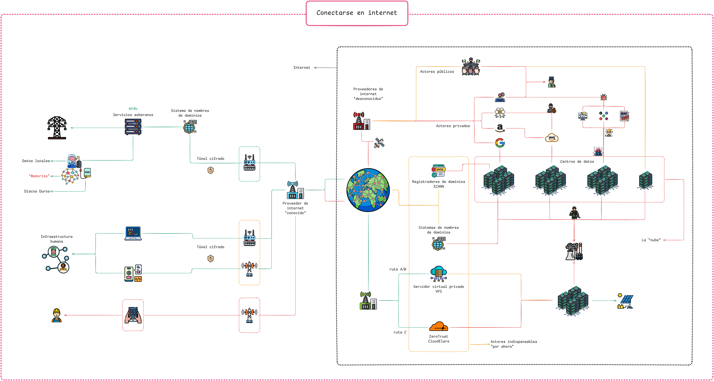

# Conectarse en internet

← [`replicación`](../replicación.md)

## ¿Qué necesitamos?

El `computador` local de la `midu` vive en una red privada, una casa, una oficina, cualquier lugar con una conexión convencional a internet. Esa conexión no tiene una IP pública fija, y exponer puertos directamente al exterior abre una superficie de ataque enorme.

La solución es un intermediario: el `computador` local abre una conexión saliente hacia un punto público en lugar de hablar directamente con internet. El tráfico llega a ese punto y es reenviado al `computador` local. Nadie en internet conoce la IP real.

La [presentación animada](../../lenguaje_común/visualizaciones/midu-conectarse_en_internet-slideshow.excalidraw.md) recorre las rutas y los actores paso a paso.

Hay tres rutas posibles. La elección depende del modelo de amenaza, el presupuesto y el nivel de [`soberanía`](../../subjetividades/soberanía_digital.md) que se quiera mantener sobre el tráfico.

## ISP, DNS y registrador de dominio

Antes de llegar a la `midu`, toda solicitud pasa por tres actores que determinan qué información se expone y a quién.

**El ISP** (proveedor de servicios de internet) asigna una IP al router y enruta todo el tráfico saliente de la red local. En contratos residenciales, esa IP es dinámica y puede cambiar; además, el ISP suele bloquear los puertos de entrada estándar (80, 443). El `computador` local no puede recibir conexiones entrantes directas desde internet y su dirección no es estable.

**El DNS** traduce el nombre de dominio al punto de entrada público de la `midu`. Sin DNS cifrado, el ISP puede ver qué dominios se consultan, aunque no el contenido de las comunicaciones. La elección de ruta determina a qué dirección IP apunta ese registro DNS: al VPS arrendado (Rutas A y B) o a la red de Cloudflare (Ruta C).

**El registrador de dominio** controla la zona DNS del nombre. Decide qué servidores de nombres son autoritativos: si se delega la zona a Cloudflare, la Ruta C queda configurada desde ese nivel; si los nameservers apuntan a un proveedor que permite editar registros directamente, cualquiera de las tres rutas es posible. Esta decisión tiene consecuencias directas sobre la `soberanía` del tráfico.

Los problemas del acceso residencial, IP dinámica y puertos bloqueados, hacen necesario un intermediario público. Las tres rutas proponen intermediarios distintos:

- **Ruta A**: el VPS arrendado con NixOS actúa como intermediario. El tráfico llega al VPS y viaja hacia el `computador` local por un túnel [WireGuard](../../lenguaje_común/lenguaje_común.md#wireguard). El ISP ve tráfico cifrado hacia el VPS; el contenido permanece protegido en todo el recorrido.
- **Ruta B**: el mismo modelo de seguridad que la Ruta A. La diferencia está en cómo se gestiona el VPS, no en cómo se protege el tráfico.
- **Ruta C**: Cloudflare actúa como intermediario. Encripta con [TLS](../../lenguaje_común/lenguaje_común.md#tls) dentro de su red y reenvía el tráfico al `computador` local. El ISP ve tráfico cifrado hacia Cloudflare; Cloudflare se dedica explícitamente a monitorear patrones de tráfico con propósitos comerciales.

El tráfico saliente de la `midu` también pasa por el ISP. Para protegerlo es necesario configurar DNS cifrado (DoH o DoT) y, opcionalmente, enrutar el tráfico saliente por el túnel del VPS. Ambas opciones están descritas en las guías de cada ruta.

## Las tres rutas

| | [Ruta A: VPS con NixOS](../replicación/rutas/ruta_A-vps+nixos.md) | [Ruta B: VPS con Podman](../replicación/rutas/ruta_B-vps+podman.md) | [Ruta C: túnel de Cloudflare](../replicación/rutas/ruta_C-cloudflare.md) |
|---|---|---|---|
| **Intermediario** | VPS arrendado con NixOS | VPS arrendado con cualquier Linux | Red de Cloudflare |
| **Costo mensual** | ~4–6 USD | ~4–6 USD | Gratuito |
| **`Soberanía` del tráfico** | Total; solo pasa por `infraestructuras` propias | Total; solo pasa por `infraestructuras` propias | Parcial; Cloudflare monitorea el tráfico con propósitos comerciales |
| **Complejidad inicial** | Alta | Media | Baja |
| **Reproducibilidad** | Muy alta (NixOS declarativo también en el VPS) | Media (depende del estado del VPS) | Alta (NixOS en el `computador` local) |
| **Gestión de secretos** | sops-nix | Archivo `.env` | sops-nix |

## Ruta A: VPS con NixOS + Pangolin + Newt

Un VPS arrendado corre [NixOS](nixos.md) con un túnel cifrado. El cliente [Newt](../servicios/túnel_cifrado.md) en el `computador` local establece la conexión [WireGuard](../../lenguaje_común/lenguaje_común.md#wireguard) hacia el VPS.

**Cuándo elegirla**: queremos `soberanía` completa sobre el tráfico; usamos NixOS y queremos consistencia declarativa también en el VPS arrendado; podemos invertir tiempo en la configuración inicial.

**La ganancia**: nadie fuera de las [`infraestructuras`](../../subjetividades/infraestructuras.md) que controlamos puede leer el tráfico. El VPS arrendado es reproducible; podemos destruirlo y reconstruirlo con el mismo estado desde el repositorio.

→ [Ruta A: VPS con NixOS](../replicación/rutas/ruta_A-vps+nixos.md)

## Ruta B: VPS con Podman (sin NixOS)

El mismo modelo que la Ruta A, VPS arrendado con túnel cifrado, pero el VPS puede correr cualquier distribución Linux. El túnel cifrado se despliega con [Podman](../servicios/virtualización.md) en lugar de NixOS.

**Cuándo elegirla**: ya tenemos un VPS arrendado corriendo otro sistema operativo; no queremos gestionar NixOS en el VPS arrendado.

**La diferencia**: la configuración depende del estado del VPS. Los secretos se gestionan con un archivo `.env` en lugar de [`sops-nix`](secretos.md).

→ [Ruta B: VPS con Podman](../replicación/rutas/ruta_B-vps+podman.md)

## Ruta C: túnel de Cloudflare

El agente `cloudflared` abre una conexión saliente hacia la red de Cloudflare. Cloudflare gestiona el certificado [TLS](../../lenguaje_común/lenguaje_común.md#tls) público y reenvía el tráfico al `computador` local.

**Cuándo elegirla**: no queremos gestionar un VPS arrendado; priorizamos la simplicidad.

**El compromiso**: Cloudflare termina el TLS en su red antes de reenviar el tráfico. Cloudflare se dedica explícitamente a monitorear patrones de tráfico con propósitos comerciales. Para una `midu` con un propósito declarado de `soberanía` digital, la decisión de usar este servicio debe ser consciente.

→ [Ruta C: túnel de Cloudflare](../replicación/rutas/ruta_C-cloudflare.md)

## Ver también

- [El túnel: Cloudflare o Newt](../servicios/túnel_cifrado.md): análisis técnico detallado de las opciones de túnel
- [Pangolin](../servicios/pangolin.md): el sistema del túnel cifrado
- [Arquitectura Zero Trust](../cuidados/zero-trust.md): el modelo de seguridad del `computador` local
- [`soberanía` digital](../../subjetividades/soberanía_digital.md): el concepto político detrás de estas decisiones
