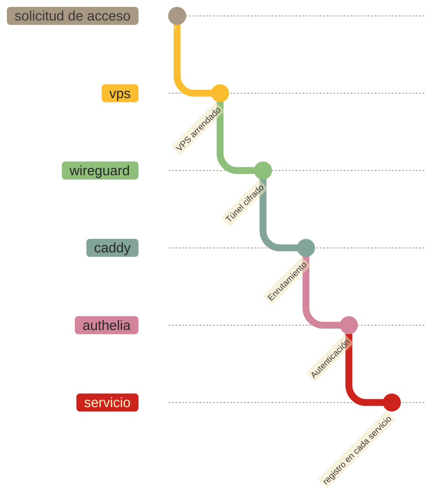

# Cuidados

← [Inicio](../../README.md#los-cuidados)

Los `cuidados` son el conjunto de prácticas y decisiones técnicas que protegen la `midu`: las personas, las `memorias` y las `infraestructuras` que las sostienen. 

Cinco principios articulan el modelo de `cuidados`.

## Defensa en profundidad

El principio más importante: ninguna capa de seguridad es la última línea de defensa.

Si el único mecanismo de protección es una contraseña, basta robar esa contraseña para tener acceso a todo. En cambio, cuando hay capas apiladas (contraseña + segundo factor + disco cifrado + tráfico cifrado), un atacante tendría que comprometer todas ellas de manera simultánea.

Esta `interfaz` tiene cuatro capas activas en todo momento:

1. El disco de `datos` está cifrado (LUKS).
2. Los secretos del sistema están cifrados (age/sops-nix).
3. El tráfico está cifrado (TLS + WireGuard).
4. El acceso requiere autenticación de dos factores (contraseña + TOTP).

Un fallo en cualquiera de ellas (por ejemplo, que alguien intercepte el tráfico TLS) no da acceso a los `datos`, porque el disco sigue cifrado y la autenticación sigue requiriendo TOTP. Cada una de estas capas está descrita en [Cifrado](cuidados/cifrado.md).

## Principio de menor privilegio

Cada componente del sistema tiene exactamente los permisos que necesita para funcionar, y ninguno más.

Algunos ejemplos:

- El usuario de base de `datos` que usa el servicio de autenticación, Authelia, puede leer y escribir solo en la base de `datos` de Authelia. No puede tocar la base de `datos` de Dendrite (el servidor de chat), ni la de ningún otro servicio.
- El `computador` desechable reenvía tráfico cifrado hacia el `computador` local. No tiene acceso a los `datos`. No puede leer correos, archivos ni mensajes.
- El usuario del sistema que ejecuta Syncthing puede acceder a los directorios de sincronización asignados. No puede modificar los archivos de Vaultwarden (el gestor de contraseñas) ni de ningún otro servicio.
- La clave SSH de despliegue (la que usa el proceso automatizado de actualización) tiene permisos de solo lectura sobre el repositorio. No puede modificar nada.

Si un componente se ve comprometido, el daño está contenido. Un atacante que toma el control del proceso de Syncthing no obtiene acceso a las contraseñas almacenadas en Vaultwarden, suponiendo que pueda llegar tan lejos.

## Separación de responsabilidades

El sistema está dividido en dos máquinas con roles claramente distintos:

- **`computador` local** (en casa o en cualquier lugar cuidado colectivamente): aquí viven los `datos`. Correo, archivos, chat, contraseñas. Esta máquina no está expuesta directamente a internet.
- **`computador` desechable**: su única función es recibir tráfico de internet y reenviarlo al `computador` local a través de un túnel cifrado. No almacena `datos`. No procesa información.

## Desconfiar de los intermediarios

El sistema está diseñado asumiendo que los proveedores del `computador` desechable (el VPS arrendado o la cuenta de Cloudflare) no son de confianza por defecto. Esta postura obliga a exponer al intermediario solo lo necesario: tráfico que no puede descifrar, sin `datos` almacenados en sus `infraestructuras`, sin acceso a los servicios internos.

Este principio responde algunas preguntas:

- ¿Qué pasa si el `computador` desechable cae o es atacado? → Los `datos` siguen en el `computador` local, cifrados en reposo. El intermediario solo tenía un servidor vacío que reenviaba tráfico cifrado.
- ¿Qué pasa si una contraseña de un servicio se filtra (por ejemplo, la contraseña de la `interfaz` web de Nextcloud)? → Aparte de la contraseña de un servicio en particular, es necesario pasar por la autenticación de dos factores con Authelia.
- ¿Qué pasa si alguien roba físicamente el servidor? → Sin la clave LUKS, el disco es ilegible.

El modelo completo de privacidad por diseño se desarrolla en [Privacidad](cuidados/privacidad.md).

## Superficie de ataque mínima

La superficie de ataque es el conjunto de puntos por donde un atacante podría intentar entrar. Cuanto más pequeña, mejor.

El `computador` local no está directamente expuesto a internet. No tiene puertos abiertos al mundo. El único camino para llegar a él es pasar por cinco puertas en serie:

El modelo de confianza que define estas puertas está descrito en [Zero Trust](cuidados/zero-trust.md).

## Ver también

- [Arquitectura](arquitectura.md): cómo está construida la `midu`
- [La `midu`](../midu.md): las `infraestructuras` detrás de la `interfaz`
- [Subjetividades](subjetividades.md): las ideas que articulan las decisiones de la `midu`